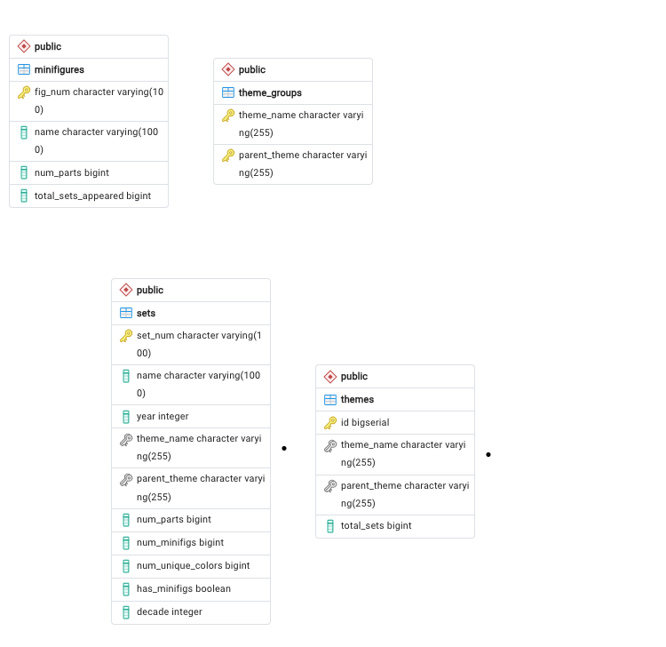
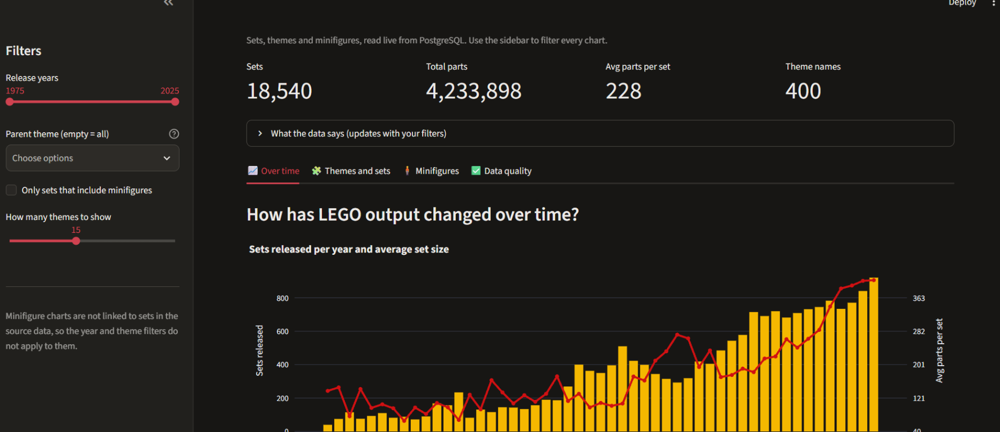

# LEGO Sets, Themes, and Minifigures

## Project overview and data source

This project extracts LEGO set, theme, and minifigure data for 1975-2025,
cleans and validates it, loads it into PostgreSQL, and presents it in an
interactive Streamlit dashboard.

The extractor uses Python `requests` to call Kaggle's dataset metadata and
versioned-download endpoints for the public dataset
[`abdurrahmanhakanacar/lego-sets-themes-and-minifigures-1975-2025`](https://www.kaggle.com/datasets/abdurrahmanhakanacar/lego-sets-themes-and-minifigures-1975-2025).
It reads the sets, themes, and minifigures CSV files from the returned archive.
The public dataset normally needs no API key. Optional Kaggle credentials are
loaded from `.env` via `python-dotenv`.

## Services and run instructions

Run these steps from the `term_project` directory:

1. Install and start Docker Desktop.
2. Copy the sample environment file:

   ```powershell
   Copy-Item .env.sample .env
   ```

3. Edit `.env` and replace `POSTGRES_PASSWORD=change_me` with a secure local
   password. The sample database name and user can be kept. If Kaggle requires
   authentication, set `KAGGLE_API_TOKEN` or both `KAGGLE_USERNAME` and
   `KAGGLE_KEY`. Do not commit `.env`.
4. Build and start the services:

   ```powershell
   docker-compose up --build
   ```

   With Docker Compose v2, `docker compose up --build` is equivalent.

Compose starts three services:

- `db`: PostgreSQL 16, available to the other services at `db:5432`. Its data
  persists in the named `pgdata` volume; the port is not published to the host.
- `etl`: retrieves and processes the data, creates the tables, writes a run
  summary, and exits when the load succeeds.
- `dashboard`: starts after ETL succeeds and is available at
  <http://localhost:8501>.

## PostgreSQL schema

The database contains four data tables:

- `theme_groups`: composite primary key `(theme_name, parent_theme)`, providing
  unique theme/parent-theme pairs.
- `themes`: primary key `id`; its `(theme_name, parent_theme)` columns reference
  `theme_groups`.
- `sets`: primary key `set_num`; its `(theme_name, parent_theme)` columns also
  reference `theme_groups`.
- `minifigures`: primary key `fig_num`. The source data does not provide a
  relationship from individual minifigures to sets.

Sets join to `theme_groups` on both `theme_name` and `parent_theme`. Joining
directly to `themes` can duplicate sets because theme names can occur under
multiple theme IDs.



The ETL pipeline also creates an `etl_runs` table for operational metadata;
it is not shown in the ERD.

## Source versioning and incremental database writes

Kaggle exposes this source as versioned CSV archives, not as a paginated
record-level API with an `updated since` parameter. The extractor requests the
current version number, downloads that version's full archive when it is not
already cached, and reads all three CSVs. Pagination does not apply to this
archive endpoint; Kaggle does not provide record-level pagination for these
files.

**Known source limitation:** this is not a source-level incremental pull. When
a new Kaggle version is published, the full snapshot must be fetched and
compared. For each cleaned table, the database compares rows by primary key:
new keys are inserted, changed values are updated, and unchanged rows are
skipped. Rows missing from a later snapshot are not deleted.

The latest successful run is stored in `etl_runs`; its highest `run_id` row
contains `run_at`, Kaggle `dataset_version`, rows received, and rows written.
The versioned archive is cached in the named `kaggle_cache` volume, avoiding a
repeat archive download when that version is already present.

## Tests

The tests are included in the ETL image and run with:

```powershell
docker-compose run --rm etl pytest
```

## Dashboard screenshot



## Group members and contributions

- **Sergio Esteves** - extraction scripts and Docker architecture.
- **Anish Yerramsetti** - dashboard.
- **Nicolas Reyes** - data transformation.
- **Ananya Sharma** - PostgreSQL database and data loading.
